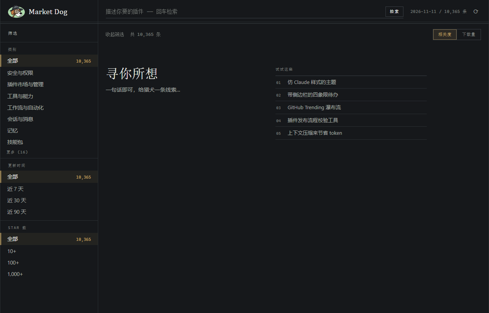
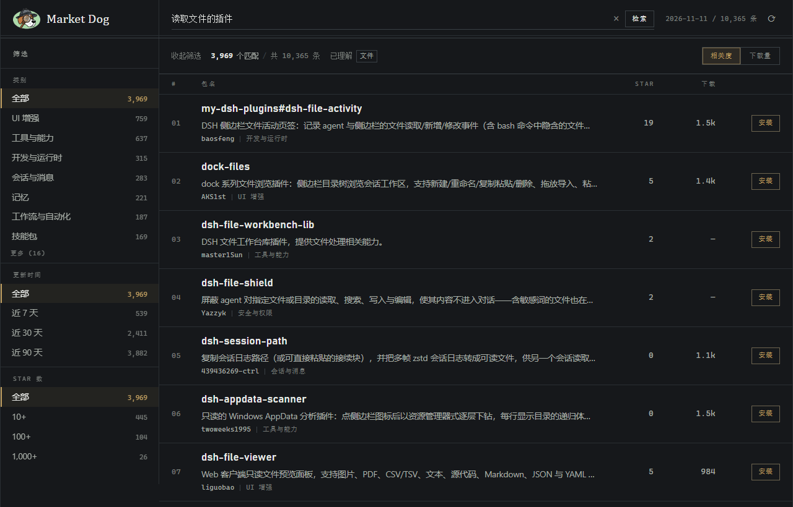

# Market Dog · 插件市场搜索插件

用一句话描述你想要的插件，直接从 DSH 插件市场里找出真正匹配的那一个。

插件市场的搜索只认关键词，插件名又几乎都是英文：想找「能让我把侧边栏图标拖动成自己的顺序」的插件，输入 *sidebar* 会出来上百个，还得逐个点开介绍才能判断是不是自己想要的。Market Dog 把这件事反过来做——你描述**要做什么**，它负责翻译成市场里的说法并排序。



## 它做什么

- **一句话搜索**：中文或英文写一段话，说清你想让插件帮你完成什么，不需要知道插件叫什么名字。
- **语义匹配**：内置中英双语词义词典，「把很长的聊天记录总结成要点」能找到 summarize 类插件；中文描述能命中英文插件，反之亦然。泛词不顶事，罕见词与原文真实出现的词权重更高。
- **筛选栏**：**类别**、**更新时间**、**Star 数**组合收窄，每个选项实时显示能捞到多少条；**双击**某个类别可直接按下载量浏览该类别的全部插件。
- **两种排序**：相关度 / 下载量一键切换，同等相关时社区更常用的插件靠前。
- **行内安装**：结果行直接安装，已装好的自动标记；点开一行可见安装命令、GitHub / npm 链接和插件截图画廊。
- **浅色 / 深色主题**跟随 DSH 设置。

## 为什么比市场搜索好用

| 市场搜索           | Market Dog                   |
| -------------- | ---------------------------- |
| 只匹配你输入的字面词     | 先从你的描述里提炼能力关键词，再做匹配          |
| 英文插件名对中文用户不透明  | 中英双向匹配：中文描述能命中英文插件，反之亦然      |
| 结果只有一堆同名/近名的条目 | 每个结果展示中文简介、分类、下载量、星标和命中的关键词  |
| 排序只有一种         | 相关度 / 下载量随时切换                |
| 得逐个点开才知道干什么    | 行内直接给出一句话简介，展开即见安装命令         |
| 只能按关键词翻页找      | 类别 / 更新时间 / Star 组合筛选，带实时命中数 |

## 使用

安装后在左侧边栏点「Market Dog」图标，或者直接说一句话开始：

- 让我可以把侧边栏图标拖动成自己的顺序
- 把很长的聊天记录总结成要点
- 在侧边栏显示股票行情和天气的小组件
- 把网页截图后自动 OCR 识别文字
- 记住我的编码习惯和项目约定
- 订阅 RSS 并每天推送摘要



回车搜索、Shift+回车换行；描述、排序偏好、筛选条件都保存在本地，下次打开还在。目录可随时在右上角后台刷新，不卡列表。

## 数据与隐私

- 你的描述只发给本机的本地服务，不上传任何第三方，也不调用大模型。
- 插件目录来自公开的 [awesome-dsh-plugin](https://awesome-dsh-plugin.com/plugins.json)，首次搜索下载一次（约 14 MB），之后走本地缓存；断网时用上次下载的目录继续工作。

## 开发

```bash
# 本地目录安装到当前 profile
dsh plugin --profile web add <this-directory>
```

结构：

- `index.js`：Host 侧。拉取并缓存插件目录，提供搜索与元数据接口。
- `lib/search.js`：纯函数评分模块（关键词提取、概念词典、相关度计算、筛选、排序）。
- `client.js`：浏览器侧。侧边栏入口与主面板。
- `locale/{zh,en}.json`：插件在市场上的标题与简介。

开发交接与设计约束见 [`docs/DEVELOPMENT.md`](docs/DEVELOPMENT.md)。

## 反馈

遇到问题请到 [Issues](https://github.com/wzvx/dsh-market-dog/issues) 反馈。

## License

MIT
